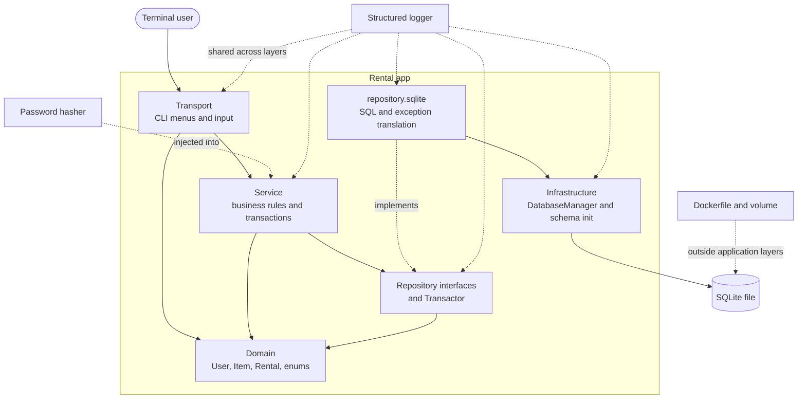
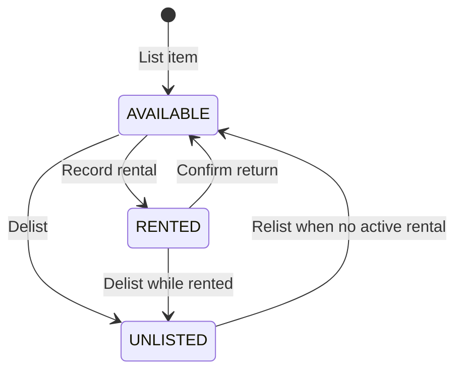

# Architecture

Single source of truth for the team. If code and this file disagree, fix one of them in the same PR. Every rule below carries its why, so a rule can be challenged on its reasoning rather than ignored.

The application uses a five-layer architecture to support multiple authenticated users.

## 1. Layers and allowed dependencies



| Layer | Package | May depend on | Must NOT depend on |
|---|---|---|---|
| Transport | `transport` | `service`, `domain`, `exception` | `repository`, `infrastructure`, `java.sql` |
| Service | `service` | Repository interfaces, `domain`, `exception`, required service abstractions | `repository.sqlite`, `infrastructure`, `transport`, `java.sql` |
| Repository API | `repository` | `domain`, `exception` | Other application layers and implementations |
| Repository implementation | `repository.sqlite` | `repository`, `infrastructure`, `domain`, `exception`, `java.sql` | `service`, `transport` |
| Infrastructure | `infrastructure` | `exception`, `java.sql` | `service`, `transport`, `repository` |
| Domain | `domain` | `exception` where required by state-machine behaviour | `transport`, `service`, `repository`, `infrastructure` |
| Exception | `exception` | Nothing | Everything else |
| Composition root | `Main` (root package) | Components required to construct the application | — |

The password hasher is supplied to the authentication service through constructor injection. Its implementation and package must respect the dependency rules above.

The structured logger is a shared cross-cutting component. All layers use a consistent event format without introducing dependencies that violate the architecture. Docker configuration sits outside the application layers.

**Why:** The specification promises that nothing above the repository writes SQL or touches SQLite. A promise in documentation can become outdated; `ArchitectureTest` (ArchUnit) makes violations fail the build.

The Service layer must also enforce business rules independently of the Transport layer. A menu that hides an unauthorised operation is not a substitute for a service-level ownership check.

## 2. Package ownership

Ownership means "primary author and final say on shape", not "only person allowed to touch it". Changes to a contract owned by someone else need that owner as reviewer.

## 2. Package ownership

Ownership means "primary author and final say on shape", not "only person allowed to touch it". Changes to a contract or file owned by someone else need that owner as reviewer.

| Package / file | Owner | Reviewer(s) |
|---|---|---|
| `infrastructure/`, `repository/`, `Dockerfile`, Docker configuration | Francis | Jack, Fidel |
| `domain/`, `exception/` | Jack and Francis (shared ownership) | Fidel |
| `service/` | Jack | Francis, Fidel |
| `transport/`, `Main.java` | Fidel | Francis, Jack |

All team members remain responsible for reviewing integration changes and keeping the documented contracts consistent with the implementation.

All team members are responsible for writing tests for the sections they work on.


## 3. Item state machine



Implemented in `ItemStatus` (`canTransitionTo` / `transitionTo`). The 3 × 3 transition matrix is tested by `ItemStatusTest`.

Authentication and ownership determine who may request a transition; they do not change the valid transitions themselves.

Two rules require access to rental data and therefore belong in the Service layer:

**Relist guard.** `UNLISTED → AVAILABLE` is legal for the state machine, but `ItemService.relist` first checks `rentals.findActiveByItemId`. If a rental is active, it throws `BusinessRuleException` ("return it first").

**Return of a delisted-while-out item.** `RentalService.confirmReturn` closes the rental. The item moves from `RENTED → AVAILABLE` only if it is still `RENTED`. If it is `UNLISTED`, it stays `UNLISTED`.

The relevant service methods must additionally verify that the authenticated user owns the item.

**Why in code, not only in the database:** the specification requires business rules to be enforced in code. The database CHECK constraints reject invalid stored values; the enum and services provide readable business errors before invalid operations reach SQL.

## 4. Authentication and user identity

The multi-user application supports multiple accounts. On launch, the Transport layer asks whether the user wants to log in or register. Registration accepts a username and password; login verifies both against the stored credentials.

`UserService` coordinates registration and authentication. Password hashing and verification are delegated to an injected password-hashing component.

Authentication requirements:

- Usernames remain unique.
- Passwords are hashed before persistence; plaintext passwords are never stored.
- Login verifies the entered password against the stored hash.
- Unknown usernames and incorrect passwords fail with a readable authentication error.
- Duplicate usernames produce a readable error rather than a raw database constraint message.
- The logged-in user is the identity used for all subsequent item and rental operations.
- Listing an item automatically associates it with the logged-in owner.
- Renting an item automatically associates the rental with the logged-in renter.
- The user does not type an owner or renter name to identify themselves during an operation.
- Exiting logs the user out and closes the application. A subsequent launch returns to the login/register prompt.

The service must not trust a user ID supplied by the Transport layer if that ID is not the authenticated identity established by the application flow.

**Why:** The application is now shared. Identity must come from successful authentication, not from arbitrary names or IDs supplied for an individual operation.

## 5. Screen → service contract

The Transport layer presents menus, collects input, and displays results. The Service layer validates inputs, enforces business rules and ownership, and coordinates repository operations.

| Menu action | Service responsibility | Notes |
|---|---|---|
| Launch → log in | `UserService` authentication operation | Verify username and password |
| Launch → register | `UserService` registration operation | Validate input, hash password, enforce unique username |
| List an item | `ItemService.listItem(...)` | Associate item with the authenticated user |
| View my inventory | `ItemService.getInventory(...)` | Return only the authenticated user's items, all statuses |
| Open an item | `ItemService.getDetails(itemId)` | Include owner username where required |
| Delist an item | `ItemService.delist(...)` | Verify ownership before changing state |
| Relist an item | `ItemService.relist(...)` | Verify ownership and reject while a rental is active |
| Browse listings | `ItemService.getAvailableItems(...)` | Exclude the authenticated user's own items; show other users' available items |
| Open listing details | `ItemService.getDetails(itemId)` | Provide details needed to decide whether to rent |
| Rent a listing | `RentalService.recordRental(...)` | Verify item exists, is available, is not owned by the renter, and duration is valid |
| View active rentals for return | `RentalService.getActiveRentals(...)` | Show active rentals for items the authenticated user owns, ordered by due date |
| Confirm a return | `RentalService.confirmReturn(...)` | Verify ownership, close rental, update item state appropriately |
| Exit | Transport/application shutdown | End the authenticated session and close resources |

Exact method signatures must match the repository and service contracts agreed by the team. The table defines responsibilities, not permission to introduce arbitrary user IDs into service calls.

### Ownership rules

The Service layer enforces ownership using stable database IDs:

- A user may list, delist, relist, and confirm returns only for items they own.
- A user may rent another user's available item.
- A user may not rent their own item.
- A user may not rent an item that is missing, unavailable, already rented, or otherwise ineligible.
- The browse list excludes the user's own items, but this is a usability measure, not an authorisation mechanism.
- Ownership checks remain mandatory even if a caller bypasses the normal menu flow.

Ownership checks must happen before repository mutations. A rejected operation must not partially modify the database.

**Return-list detail:** the return flow selects an active rental, not merely an item whose current status is `RENTED`. An item delisted while rented is `UNLISTED` but still has an active rental. Filtering only by item status would make it impossible to confirm that return.

## 6. Validation of untrusted input

Every input comes from a user and must be treated as untrusted.

Validation for `User`, `Item`, and `Rental` fields is centralised, with one clear validation location per entity. The Service layer applies the relevant validator before invoking repository operations. Transport handlers collect input and delegate validation instead of duplicating field-by-field business rules.

Required validation includes:

- Required strings must not be empty or whitespace-only.
- Usernames must satisfy the agreed username rules and uniqueness requirement.
- Passwords must satisfy the agreed password requirements.
- Item costs must not be negative.
- Rental duration must be at least one day.
- Referenced items must exist.
- A user cannot rent their own item.
- An item must be eligible for renting before a rental is created.
- Ownership must be checked before delisting, relisting, or confirming a return.

Validation failures use typed exceptions, such as `ValidationException` or the existing appropriate business-rule exception. They must be raised before invalid data reaches the repository.

A rejected input produces a readable user-facing message. Internal context, including the entity, field, and reason, is recorded in the structured log without exposing sensitive credentials.

**Why:** Centralised validation prevents inconsistent rules across entry points and keeps invalid data out of persistence operations.

## 7. Decisions and their reasons

| # | Decision | Why |
|---|---|---|
| D1 | Unchecked exceptions. `DatabaseException` extends `RuntimeException`; `BusinessRuleException` is a separate unchecked tree. | Repositories translate checked `SQLException` once, so upper layers do not declare SQL exceptions. Business failures are not database failures. |
| D2 | Four constraint subtypes under abstract `ConstraintViolationException`: Unique, ForeignKey, NotNull, Check. | The repository exception translator provides precise failure types for tests and error handling. |
| D3 | `findX` returns `Optional`; `getX` throws `NotFoundException`; updates affecting zero rows throw `NotFoundException`. | Absence is normal for some lookups but an error when an operation expects a record. |
| D4 | `Transactor` lives in `repository` and is implemented in `repository.sqlite`. Services own transaction boundaries. | Creating a rental and changing item status must succeed or fail together. Nested calls join the outer transaction; a `RuntimeException` rolls back. |
| D5 | Domain records remain free of constructor-based validation; explicit validators run at the Service boundary. | Invalid values can be tested independently, and the application rejects user input before persistence. Entity validation must have one authoritative location per entity. |
| D6 | `ItemStatus.fromDbValue` throws `IllegalArgumentException`; the repository mapper wraps it in `MappingException`. | The domain stays independent of persistence exceptions while malformed rows produce a typed mapping failure. |
| D7 | Read models `RentalDetails` and `ItemDetails`. | Joined queries return details such as item name and renter/owner username without an N+1 query pattern. |
| D8 | Inject `Clock` into `RentalService`; `Main` passes `Clock.systemUTC()`. | Rental start and end times are testable with a fixed instant. |
| D9 | Store timestamps as UTC ISO-8601 text `yyyy-MM-dd'T'HH:mm:ss.SSS'Z'`; use `LocalDateTime` in the domain and format for display in Transport. | One UTC representation keeps timestamps consistent and comparisons predictable. |
| D10 | No static singletons; constructor injection is wired in `Main`. `DatabaseManager` takes a `Path` and owns connection creation/configuration, not a persistent application-wide connection. | Tests can construct the app against a temporary database. Normal operations own a connection for their duration; an active transaction shares one connection across participating repositories and closes it at commit or rollback. |
| D11 | Console I/O is injected (`ConsoleInput` reads an `InputStream`; menus write to a `PrintStream`). | Injected I/O supports deterministic tests and coverage. ArchUnit forbids `System.in/out/err` outside Transport and `Main`. |
| D12 | Pagination is in memory, in Transport, through one reusable list screen. | Lists are small; SQL stays simple, and the list screens share behaviour. |
| D13 | Every account can own items and rent other users' items. | Each account can own items and rent items owned by other users. |
| D14 | Coverage gate is opt-in (`mvn verify -Pcoverage-gate`). | The report is produced during testing, while the gate can be enabled explicitly. The team must verify all new service methods and existing tests before delivery. |
| D15 | No self-rental. The renter must differ from the item's owner. | Owners cannot rent their own items. `RentalService` compares stable user IDs. |
| D16 | `cost_per_day` is represented by `BigDecimal` in Java and stored as `TEXT` in SQLite. | SQLite has no dedicated decimal type; TEXT preserves the exact decimal representation. |
| D17 | Minimum rental duration is one day. | Zero-day and negative-duration rentals are invalid. Service validation rejects them before persistence. |
| D18 | Passwords are hashed before storage using a password-hashing library, such as Password4j with bcrypt or Argon2id. | Database contents must not expose plaintext passwords. Login verifies the entered password against the stored hash. |
| D19 | Password hashing and verification are delegated to an injected component used by `UserService`. | Authentication logic remains testable and avoids coupling business rules to a particular hashing implementation. |
| D20 | Structured logging uses a shared event format across application layers. | Logs need consistent timestamps, levels, event names, and context fields so failures can be reconstructed. |
| D21 | Passwords are never logged, in plaintext or hashed form. | Logs can be accessed or retained separately from the database and must not leak authentication credentials. |
| D22 | The Service layer enforces ownership on every protected item operation. | Menu filtering is not a security boundary. Calls that bypass Transport must still be rejected. |
| D23 | Recoverable operation failures return control to the menu with a readable message; unrecoverable startup failures are logged and terminate the application. | Users can recover from invalid input and business-rule failures, while an unusable database must not lead to continued operation in an invalid state. |
| D24 | Database resources are closed on success and failure. | Exceptions must not leave connections or transactions dangling. |
| D25 | Docker runs the application with SQLite stored on a mounted persistent volume. | Container replacement, rebuilding, and restarting must not erase application data. |

## 8. Rules for the database layer

The database schema remains in `schema.sql` and is initialised through `DatabaseManager`.

- `PRAGMA foreign_keys = ON` on every connection. SQLite ignores foreign keys by default; every connection must enable them.
- CHECK on `listed_items.status` (`available`, `rented`, `unlisted`).
- CHECK on `rentals.status` (`active`, `closed`).
- Status values must match `ItemStatus.dbValue()` and `RentalStatus.dbValue()`.
- CHECK on `rentals.end_time > rentals.start_time`.
- CHECK on `listed_items.cost_per_day`.
- Partial unique index on `rentals(item_id)` where status is `active`.
- Foreign keys use `ON DELETE RESTRICT`.
- Usernames have a uniqueness constraint.
- The users table stores a password hash, never a plaintext password.
- Item ownership is represented by `listed_items.owner_id`.
- Rentals reference their item and renter through foreign keys.

The Service layer remains responsible for business authorisation and readable error handling. Database constraints are the final integrity boundary, not a replacement for service checks.

Any new or modified schema constraints must be documented in `docs/database-design.md` and reflected in the ER diagram.

## 9. Structured logging and error handling

The application writes structured log entries using a shared format:

`timestamp | level | event | context fields`

Example events:

```text
2026-03-15T02:14:08Z | INFO  | rental.created    | rental_id=42 item_id=7 renter_id=3
2026-03-15T02:14:33Z | WARN  | validation.failed | entity=Item field=cost reason=negative
2026-03-15T02:14:38Z | ERROR | db.query          | op=rental.create error=constraint_violation
```

The exact logger implementation and output destination must be consistent with the chosen logging dependency and team configuration.

Required logging behaviour:

- Log validation failures with appropriate severity and non-sensitive context.
- Log database exceptions and unexpected exceptions with useful internal detail.
- Log recoverable failures that result in a return to the menu.
- Log key events such as item listing, rental creation, and return confirmation.
- Log database connection opening at startup and closing on exit.
- Never log passwords, whether plaintext or hashed.
- Do not expose SQL error codes, stack traces, or internal exception details to end users.

Error handling distinguishes between:
- **Validation and business-rule failures:** show a readable message and return to the menu.
- **Constraint violations:** translate to the appropriate typed exception, log the internal reason, and handle as a recoverable operation failure where appropriate.
- **Missing or malformed data:** convert missing records and mapping failures into typed, deliberate errors rather than letting unexpected exceptions crash the menu.
- **Unrecoverable startup failures:** log the failure and terminate instead of running without a usable database.

Resources must be closed in `finally`-safe or try-with-resources code paths. Transactions must roll back when an operation fails.

## 10. Testing conventions

Tests use real SQLite databases, isolated per test with JUnit `@TempDir` where appropriate. Do not substitute mocks for the database in tests intended to verify persistence, SQL constraints, transactions, or service behaviour.

Each test should establish known data, perform one operation, and verify the resulting database state directly.

- Repository tests verify CRUD behaviour, mapping, exception translation, transactions, and database constraints.
- Service tests verify state transitions, authentication, validation, ownership, and business rules.
- Logging tests verify expected events, severity levels, and context fields, and ensure passwords never appear in logs.
- Architecture tests enforce allowed package dependencies.
- Tests must pass in any order without shared state.
- Every new service-layer method must have tests.
- The original test suite must continue to pass.
- JaCoCo generates the coverage report; the team aims for 100% line and branch coverage and must explain any remaining gaps.

## 11. Container configuration and persistent data

The repository includes a `Dockerfile` that builds and runs the application.

The SQLite database must live at a path backed by a Docker-mounted volume. The database path used by the application, the Docker configuration, and the run instructions must agree.

Stopping or rebuilding a container must not delete persisted users, items, or rentals. Database initialisation must work when the volume is empty and must not fail by attempting to recreate tables that already exist.

Docker configuration remains outside the five application layers.

## 12. Seed data and delivery requirements

The repository must contain:

- A working CLI application with all required tests passing.
- A JaCoCo coverage report.
- A `Dockerfile` and persistent volume configuration.
- A seeded database with at least two users and six listed items distributed across them.
- An ER diagram covering `users`, `listed_items`, and `rentals`, including columns, types, constraints, and relationships.
- Git history demonstrating teamwork through reviewed pull requests, small focused commits, and clear commit messages.

The demonstration must cover registration, logout and login; listing and renting another user's item; a rejected input with a readable message and corresponding log entry; confirming a return as the owner; persistence after a Docker restart; and the test suite.

## 13. Decisions made as a team

Record additional architectural decisions here as they are agreed upon. Each entry should include the decision, why it was made, and how it is enforced or tested.

Do not document an implementation choice as settled until the team has agreed on it and the code reflects it. If an existing decision changes, update the relevant decision rather than silently leaving conflicting rules in the document.
